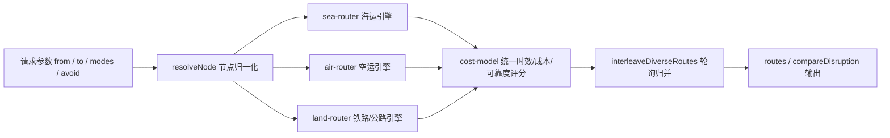

# Multimodal Router 算法与架构设计文档

本文档说明 **Multimodal Router** 的多式联运路径计算原理、图谱构建方式、评分模型及缓存工程模式，所有参数与流程均与当前源码保持一致，便于后续维护与参数调优。

---

## 1. 总体架构与设计定位

本项目是**零第三方运行时依赖**的宏观供应链多式联运路径引擎（基于 Node.js 24 ESM + 内置 `node:sqlite`）。

在路径搜索策略上，引擎**并未**构建单一跨模态超图做全局联合搜索（如自由组合任意海空联运），而是采用**“分模态独立寻路 + 统一指标评分 + Round-Robin 多样性归并”**的三段式架构：



### 核心模块索引

| 模块路径 | 职责说明 |
| --- | --- |
| [`scripts/build-graph.mjs`](../scripts/build-graph.mjs) | 离线编译 MARNET 海运网、港口、机场、精选走廊与咽喉为版本化不可变图产物 `data/compiled/graph.json` |
| [`src/engine/router.mjs`](../src/engine/router.mjs) | 引擎主入口：节点解析与搜索、分模态调度、Round-Robin 归并、`compareDisruption` 中断对比 |
| [`src/engine/sea-router.mjs`](../src/engine/sea-router.mjs) | 海运引擎：门户港匹配（含集疏港短驳）、MARNET 二叉堆 Dijkstra、咽喉消融绕行生成 |
| [`src/engine/air-router.mjs`](../src/engine/air-router.mjs) | 空运引擎：门户机场匹配、直飞与 1 跳货运枢纽枚举、大圆航线空域穿行检测 |
| [`src/engine/land-router.mjs`](../src/engine/land-router.mjs) | 陆运引擎：精选走廊图迭代边惩罚 K 最短路（铁路/轮渡/公路）与短途公路直达回退 |
| [`src/engine/cost-model.mjs`](../src/engine/cost-model.mjs) | 统一指标模型：基于静态模态参数计算 `distanceKm`、`transitDays`、`costIndex`、`reliabilityScore` |
| [`src/engine/geo.mjs`](../src/engine/geo.mjs) | 基础地理计算：经度归一化、Haversine 球面距离、大圆采样点、包围盒相交检测、折线抽稀 |
| [`src/cache/route-cache.mjs`](../src/cache/route-cache.mjs) | 双层持久化缓存：L1 内存 LRU + L2 SQLite WAL + 并发 Single-Flight 去重 + `graphVersion` 隔离 |
| [`scripts/precompute.mjs`](../scripts/precompute.mjs) | 离线预计算：批量预热重点 OD × 咽喉场景写入 SQLite，并产出 `precomputed.json` 与咽喉倒排索引 |

---

## 2. 图谱构建与节点解析

### 2.1 MARNET 海运网编译（`buildMarnetGraph`）

在 [`scripts/build-graph.mjs`](../scripts/build-graph.mjs) 中，原始 `marnet_searoute.geojson` 会经过以下预处理：
1. **跨 180° 经线规范化**：将所有坐标经度规范化到 `[-180, 180)` 并保留 4 位小数（`180` 统一折算为 `-180`），保证跨太平洋航线连续拼接。
2. **T 型节点切分**：统计所有线要素端点与多线交汇点，在交叉处切分折线生成图顶点与无向边，每条边累加球面距离 `distanceKm`。
3. **折线抽稀（`decimateCoords`）**：保留起终点，中间点等距抽稀至最多 6 个坐标点，控制产物与接口响应体积。
4. **连通分量校验**：编译后验证连通性，形成 **6,704 顶点 / 12,954 边** 的单连通海运网络。

### 2.2 空间网格吸附（`buildSpatialGrid` / `snapToMarnet`）

港口节点通过 2° 经纬度空间网格（`cellDeg = 2`）吸附到最近的 MARNET 顶点：
- 从目标所在网格出发，按网格半径 `[1, 2, 4, 6]` 逐层向外扩展搜索（支持跨 ±180° 经线回卷）。
- 最大允许吸附距离为 **220 km**，记录 `marnetVertexId` 与 `snapDistanceKm`。

### 2.3 节点标准编码与解析优先级（`resolveNode`）

引擎对外支持多种起终点入参格式，[`src/engine/router.mjs`](../src/engine/router.mjs) 中 `resolveNode` 按以下优先级归一化：
1. **经纬度对象**：`{ lon, lat }`（若附带已知 `id` 则直接复用已有节点，否则构造 `COORD_<lon>_<lat>` 自定义节点）。
2. **精确 `id` 匹配**：优先匹配标准编码（5 位 `UN/LOCODE`、3 位 `IATA`、2 位 `ISO-3166-1` 或语义编码 `CP_*` / `AS_*`）。
3. **历史旧 ID（`legacyIds`）**：如 `CITY_SZ` → `CNSZX`、`PORT_YANTIAN` → `CNYTN`，确保旧调用共享同一缓存键。
4. **经纬度字符串**：匹配 `"lon,lat"` 格式（如 `"114.05,22.54"`）。
5. **标准 `code` 匹配**：大写 `node.code` 查找（精选节点 `curated` 优先于原始数据集条目）。
6. **中英文别名匹配**：命中后按 `curated (+100)`、`type === 'city' (+30) / 'port' (+20) / 其他 (+10)`、`isMajor (+5)` 排序取最高分。

---

## 3. 海运寻路引擎（`src/engine/sea-router.mjs`）

### 3.1 门户港匹配（`selectGatewayPorts`）

当起终点不是已绑定 `marnetVertexId` 的港口时，按三层策略筛选门户港并自动拼接首尾短驳段（`drayage`）：
1. **显式陆铁集疏港走廊优先**：读取 `landConnectionsByNode` 中直连的港口（距离可超过普通短驳上限，如利雅得 ↔ 吉达/达曼）。
2. **周边港口匹配**：搜索 `maxDistanceKm`（默认调用起运地 `180 km` 最多 `2` 个，目的地 `220 km` 最多 `4` 个）内带 `marnetVertexId` 的港口，按以下打分函数升序排序并按 `marnetVertexId` 去重：
   $$\text{score} = d - 220 \cdot \text{isHomePort} - 150 \cdot \text{isHub} - 120 \cdot \text{isCuratedPort} - 80 \cdot \text{isMajor} - 20 \cdot \mathbb{I}(\text{type}=\text{'port'})$$
   - 已有优选门户时，自动过滤非合格小港及名称含 `petroleum` / `lpg` / `terminal` 的非精选专业码头。
   - 非本地同址港口的公路短驳距离按直线距离乘以迂回系数 `ROAD_CIRCUITY = 1.25` 估算；直线距离 `> 60 km` 且非主港标记为 `isRemoteAlternate = true`。
3. **内陆回退**：若上述均无结果，则将搜索半径放宽至 **900 km**，选取最近的最多 **2** 个主要/精选港口。

### 3.2 核心寻路与咽喉联动（`shortestVertexPath`）

- **算法**：在 MARNET 邻接表上运行**手写二叉最小堆（`MinHeap`）Dijkstra**，以航段 `distanceKm` 为边权。
- **默认屏蔽北极航道**：除非显式传入 `allowArctic = true`，否则默认将 `CP_NORTHWEST`（西北航道）与 `CP_BERING`（白令海峡）加入禁用集。
- **咽喉耦合扩展（`coupledPassages`）**：定义于 [`data/curated/chokepoints.json`](../data/curated/chokepoints.json)，避让 `CP_SUEZ`（苏伊士运河）时自动联动禁用 `CP_BAB`（曼德海峡），反之亦然，避免生成“穿过曼德海峡却不到苏伊士”的无效路径。

### 3.3 多路径与战略绕行生成（Chokepoint Ablation）

1. **门户组合评估**：计算 `主起运港 × 全部目的港` 以及 `次起运港 × 主目的港` 的最短海运路径。
2. **咽喉消融（Ablation）**：针对主起运港 × 主目的港的基线路径，遍历其经过的所有 `major` 咽喉，逐一将该咽喉（及其耦合咽喉）加入临时禁用集重跑 Dijkstra，生成真实战略绕行方案（如绕避苏伊士运河走好望角 `CP_CAPE`，并附带 `detourReason`）。
   - 若已避让 `CP_SUEZ`，则跳过对 `CP_CAPE` 的二次消融。
   - 若绕行海运距离超过基线的 **2.4 倍**，则视为无效折返并丢弃。
3. **排序、去重与主备判定**：
   - 按 `transitDays` → `costIndex` → `distanceKm` 升序排列。
   - 若两条路径经过完全相同的咽喉集合（`cpSig`）且起运港间距 `< 150 km`、目的港间距 `< 150 km`，仅保留最优一条（同城港口群去重）。
   - `likelihood` 判定：排序第一或 `transitDays <= minDays + 1.5` 标记为 `primary`，其余为 `alternative`。

---

## 4. 空运寻路引擎（`src/engine/air-router.mjs` & `src/engine/geo.mjs`）

空运不依赖静态航线图，而是基于全球机场库与货运枢纽直接进行几何计算：

1. **门户机场筛选（`selectGatewayAirports`）**：
   - 若起终点本身为机场，直接选用（短驳 `0 km`）。
   - 否则搜索起运 `200 km` / 目的 `220 km` 内的机场（各取前 `2` 个），打分公式：
     $$\text{rank} = d - 50 \cdot \text{curated} - 35 \cdot \text{isHub} - 15 \cdot \text{isMajor}$$
2. **直飞与次选起运机场**：
   - 主起运机场 ↔ 主目的机场大圆距离 `≤ 13,500 km` 且未触发禁用机场/空域时，生成直飞方案。
   - 若存在第二起运机场（如深圳经香港机场 `HKG`），同样按 `≤ 13,500 km` 且不触碰禁用空域生成备选直飞方案。
3. **1 跳货运枢纽枚举**：
   - 遍历所有 `isHub` 货运枢纽（排除与起运或目的机场同国家的枢纽），筛选满足以下约束的中转方案：
     - 两段大圆距离 `d1`、`d2` 均在 `800 ~ 13,500 km` 之间；
     - 总绕路比 `(d1 + d2) / max(1, directKm) <= 1.45`；
     - 两段航线均不穿过 `avoidSet` 中的受控空域。
   - 按总航程升序排列，选取最多 **3** 个枢纽，且已选枢纽之间球面距离需 `≥ 400 km`（防止同一区域枢纽重复）。
4. **空域穿行检测（`greatCircleIntersectsBoxes`）**：
   - 沿大圆航线均匀采样 **29 个点**（`steps = 28`），逐点检测是否落入 `data/curated/chokepoints.json` 中受控空域（如 `AS_RUSSIA`、`AS_MIDEAST`）的经纬度包围盒。
5. **排序与主备判定**：按 `transitDays` 升序排列，最优或直飞方案为 `primary`，中转方案为 `alternative`。

---

## 5. 陆运（铁路 / 公路）寻路引擎（`src/engine/land-router.mjs`）

### 5.1 底图结构

陆运网络完全基于 [`data/curated/rail-land-corridors.json`](../data/curated/rail-land-corridors.json) 构建，涵盖：
- **中欧班列北线**：阿拉山口（`CNALA`）/ 霍尔果斯（`RB_KHORGOS`）— 哈萨克斯坦 — 莫斯科 — 马拉舍维奇（`PLMLW`）— 杜伊斯堡（`DEDUI`）及欧洲干线。
- **西伯利亚大铁路线**：满洲里（`CNMZH`）— 后贝加尔斯克（`RUZAB`）— 西伯利亚干线。
- **跨里海中间走廊**：经阿克套港（`KZAAU`）— 里海轮渡（`SEA_CASPIAN`，`mode: 'sea'`）— 巴库港（`AZBAK`）— 第比利斯（`GETBS`）— 伊斯坦布尔（`TRIST`）— 中东欧。
- **港口陆铁接驳与区域走廊**：重点内陆城市与门户港之间的铁路/公路连线（如利雅得—达曼/吉达、墨西哥城—曼萨尼约等）。

### 5.2 迭代边惩罚 K 最短路（`dijkstraLand`）

由于精选走廊图规模较小，引擎采用**迭代边惩罚法（Iterative Penalty Dijkstra）**生成最多 `maxAlternatives = 4` 条差异化陆路方案：
1. 每轮运行基础 Dijkstra（支持跳过 `avoidSet` 中的禁用节点或边）。
2. 将选中的连续同 `mode` 且同 `corridor` 边合并为可读的 `leg`；若途径口岸（`rail_border` / `border`）或渡轮海域（`sea_area`），记录为 `chokepoints`。
3. 对本轮路径中的**非公路干线边**施加累积惩罚系数（`mode === 'road'` 不加罚，防止在起终点附近城市间绕圈）：
   - 目标节点为 `rail_border` 或 `sea_area` 的边：权重乘以 **`2.6`**；
   - 其他铁路干线边：权重乘以 **`1.35`**。
4. 重复搜索直至达到上限或无可达路径，按路径所经口岸签名去重。

### 5.3 回退与主备判定

- **同节点请求**：直接返回 `25 km` 的本地配送（`mode: 'local'`）。
- **区域公路直达回退**：若走廊搜索无结果且起终点大圆距离 `≤ 350 km`，生成单段 `区域公路直达` 方案。
- **主备判定**：按 `transitDays` 升序排列，最快或 `transitDays <= bestDays + 2.5` 标记为 `primary`，其余为 `alternative`。

---

## 6. 统一评分、多模态归并与中断对比

### 6.1 模态静态参数（`MODE_PROFILES`）

定义于 [`src/engine/cost-model.mjs`](../src/engine/cost-model.mjs)：

| 运输方式 | 平均速度 (`speedKmh`) | 固定滞留天数 (`fixedDwellDays`) | 中转滞留天数 (`transferDwellDays`) | 每千公里成本 (`costPer1000Km`) | 基础成本 (`baseCost`) | 中转成本 (`transferCost`) | 可靠度基线 (`reliabilityBase`) |
| --- | --- | --- | --- | --- | --- | --- | --- |
| 海运 (`sea`) | `35` (~19 节) | `3.5` | `—` | `1.0` | `1.5` | `—` | `0.88` |
| 空运 (`air`) | `820` | `1.2` | `0.6` | `14.0` | `4.0` | `2.5` | `0.93` |
| 铁路 (`rail`) | `45` (含换装通关) | `2.5` | `—` | `3.2` | `2.0` | `—` | `0.82` |
| 公路 (`road`) | `55` | `0.35` | `—` | `4.5` | `0.4` | `—` | `0.90` |
| 本地 (`local`) | `40` | `0.3` | `—` | `2.0` | `0.3` | `—` | `0.97` |

### 6.2 分段与整线评分公式（`estimateLegMetrics` / `scoreRoute`）

1. **短驳段（`leg.kind === 'drayage'`）**：
   - 铁路短驳：`days = dist / 50 / 24 + 0.35`，`cost = (dist / 1000) * 3.8 + 0.35`
   - 远程替代港（`isRemoteAlternate`）：`days = dist / 45 / 24 + 0.9`，`cost = (dist / 1000) * 14.0 + 1.1`
   - 本地公路短驳：`days = dist / 50 / 24 + 0.25`，`cost = (dist / 1000) * 8.0 + 0.35`
2. **干线段（`leg.kind === 'trunk'`）**：
   - 基础计算：`days = dist / speedKmh / 24 + dwellDays`，`cost = (dist / 1000) * costPer1000Km + baseCost`
   - 特殊加权：铁路含渡轮（`mode === 'rail' && leg.hasFerry`，如里海渡轮）`dwellDays += 0.8`；海运次要港口（`isSecondaryPort`）`dwellDays += 0.5`、`baseCost += 0.6`。
3. **整线可靠度（`reliabilityScore`）**：
   $$\text{reliabilityScore} = \text{clamp}\big(0.4,\; 0.99,\; \text{reliabilityBase} - \text{transferCount} \times 0.025 - \text{chokepointCount} \times 0.015\big)$$
   其中 $\text{transferCount} = \max(0, \text{legs.length} - 1)$。

### 6.3 多模态归并与中断对比（`src/engine/router.mjs`）

- **Round-Robin 轮询归并（`interleaveDiverseRoutes`）**：依次从 `sea`、`air`、`rail`、`road`、`local` 非空桶中各取第 `idx` 条路径，确保在 `maxRoutes` 截断下仍保留跨运输方式的多样性。
- **中断对比（`compareDisruption`）**：
  - 内部以 `maxRoutes = 12` 分别计算 `baseline`（`avoid = []`）和 `disrupted`（带入 `avoid`）；
  - 识别经过受阻咽喉（含耦合咽喉）的基线路径作为 `affected`；
  - 将 `disrupted` 路径按 `rail`/`road` 归入 `landSubstitutions`，其余归入 `alternatives`，并相对于基线同模态最优（若无则取基线第一条）计算 `deltaDays` 与 `costMultiplier`；
  - 汇总 `impactSummary`（含 `seaCutOff`、`seaDetoured`、`survivingSeaCount`、`bestAlternativeDays`、`bestLandDays`）。

---

## 7. 缓存与预计算模式（参考 WorldMonitor）

路径寻路算法本身为自研轻量实现，**工程缓存与预计算架构**参考了 WorldMonitor 的“避免冗余重算”模式：

1. **版本化不可变图产物（`graphVersion`）**：[`scripts/build-graph.mjs`](../scripts/build-graph.mjs) 对编译图谱计算确定性 SHA-256 指纹。图谱不变则缓存永久有效；图谱重新编译后，`pruneOldVersions()` 自动清理旧版本缓存。
2. **双层持久化缓存 + Single-Flight（[`src/cache/route-cache.mjs`](../src/cache/route-cache.mjs)）**：
   - **参数规范化**：对 `modes`、`avoid` 去重排序，所有别名/旧 ID 经 `resolveNode` 归一化后生成 SHA-256 `cache_key`。
   - **三级命中链**：L1 内存 `Map` LRU（默认上限 `2,000` 条）→ L2 SQLite WAL（`var/route-cache.sqlite`）→ `inFlight` 并发 Single-Flight 去重。
3. **离线批量预热与倒排索引（[`scripts/precompute.mjs`](../scripts/precompute.mjs)）**：
   - 批量计算预置 **87 条重点 OD × 5 个咽喉场景**（基线及苏伊士、霍尔木兹、马六甲、巴拿马受阻），同时写入带几何与不带几何的缓存条目及 `compare` 结果。
   - 原子写入 `data/compiled/precomputed.json`，产出**咽喉倒排索引（`chokepointIndex`）**（含 `must` / `main` / `shared` / `alt_only` 节点暴露度）以及兼容 `supply-chain-risk-radar` 的静态快照。

---

## 8. 业界方法对比与维护指南

### 8.1 复用与未引入的技术栈对照

| 维度 | 本项目做法 | 主流重型方案（未引入） | 取舍原因 |
| --- | --- | --- | --- |
| **海运底图** | 复用 `eurostat/searoute`（MARNET） | 商业 AIS 航迹聚类图 | MARNET 开源标准、经拓扑切分后仅 6,704 顶点，足够宏观航线评估 |
| **海运寻路** | 二叉最小堆 Dijkstra + 咽喉消融 | A* / Contraction Hierarchies (CH) | 几千顶点单次 Dijkstra 仅毫秒级，叠加双层缓存无需引入预处理复杂度 |
| **空运/标准** | 复用 OurAirports、UN/LOCODE、IATA | OAG/航司时刻表 + 航班图 | 宏观货运只需门户机场与 1 跳货运枢纽，大圆距离 + 包围盒检测更轻量 |
| **陆运寻路** | 精选走廊图 + 迭代边惩罚 K 最短路 | OSRM / Valhalla（OSM 全量路网）、Yen's KSP | 无需维护数十 GB OSM 路网，走廊图可直接表达跨里海渡轮与口岸约束 |
| **多式联运** | 分模态独立寻路 + 统一评分 + 轮询归并 | OpenTripPlanner / RAPTOR / 跨模态超图 / 帕累托多目标 | 无班期时刻表依赖，保持零第三方运行时依赖与可解释的指标对比 |

### 8.2 日常维护与更新流程

- **调整海运咽喉、空域包围盒或陆铁走廊**：编辑 `data/curated/chokepoints.json` 或 `data/curated/rail-land-corridors.json` 后，执行：
  ```bash
  npm run build:graph && npm run precompute && npm test
  ```
- **调整速度、滞留天数或成本系数**：修改 `src/engine/cost-model.mjs` 后（无需重编图谱），若后台服务正在运行，执行重建命令清空旧缓存并重新预热：
  ```bash
  npm run service:rebuild
  ```
- **更新 HTTP 接口定义**：修改 `public/api-docs-data.js` 后，运行 `npm run docs:api` 同步更新 [`docs/API.md`](API.md)。
